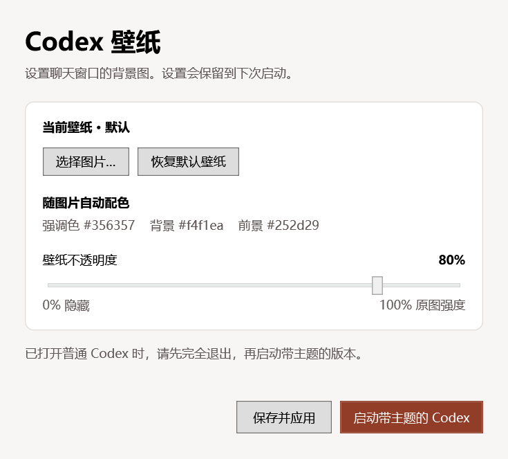
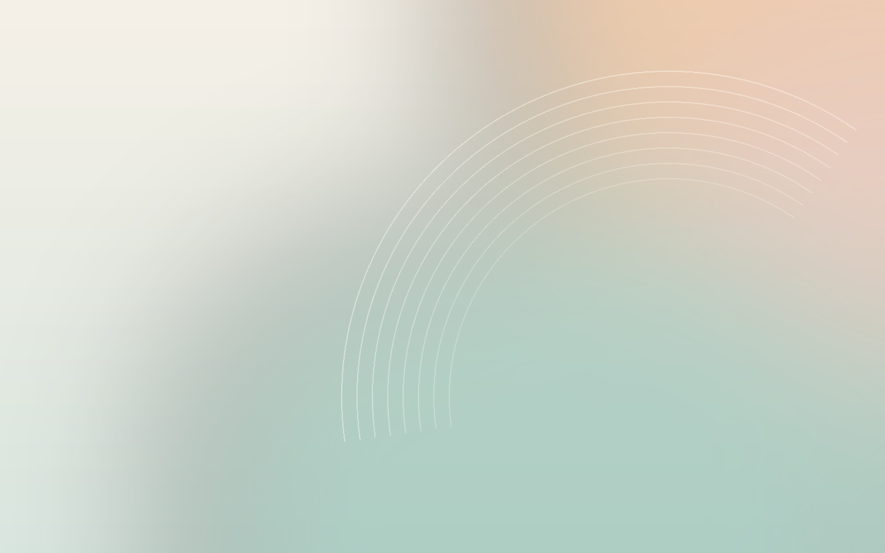

# Wallpaper Desk

[简体中文](README.zh-CN.md) · [Release v0.1.0](https://github.com/Phoenitree/wallpaper-desk/releases/tag/v0.1.0) · [Download ZIP](https://github.com/Phoenitree/wallpaper-desk/releases/download/v0.1.0/WallpaperDesk-v0.1.0.zip)

Wallpaper Desk is an independent Windows utility for putting a local image behind chat content in the Microsoft Store edition of Codex. It adds wallpaper opacity and automatically extracts an accent, surface color, and text color from the selected image.

## Control panel



The v0.1.0 control panel is in Simplified Chinese. The main controls are **选择图片…** (Choose image), **保存并应用** (Save and apply), and **启动带主题的 Codex** (Launch themed Codex).

## Install and use

1. Install Codex from the Microsoft Store. Install Python 3.11 or newer and make sure it is on PATH.
2. [Download and extract the ZIP](https://github.com/Phoenitree/wallpaper-desk/releases/download/v0.1.0/WallpaperDesk-v0.1.0.zip). Run `python -m pip install -r requirements.txt` in the extracted folder to enable image color extraction.
3. Fully quit any regular Codex session, then double-click `Open-WallpaperDesk.vbs` and choose **启动带主题的 Codex**.
4. Select a PNG, JPEG, or WebP image up to 12 MB. Set the opacity and click **保存并应用**. At 0% the wallpaper is hidden. **恢复默认壁纸** restores the included abstract image.

You can also start the themed app directly with `wscript.exe Open-WallpaperDesk.vbs start`. Per-user settings and logs are stored under `%LOCALAPPDATA%\WallpaperDesk`.

## Included artwork



## Compatibility and rights

The tool uses a local-only Chromium debugging port while the themed session runs. Other programs on the same machine may be able to connect to that port. Quit themed Codex to close it. Codex updates may require stylesheet changes. Applying a new image or restoring the bundled image also updates the three native appearance colors where the local configuration format is supported.

Wallpaper Desk is an unofficial project with no affiliation or endorsement from OpenAI. The project code and its procedurally generated abstract image are licensed under [MIT](LICENSE). Use local images you have permission to use and redistribute.

## Developer checks

```powershell
powershell.exe -NoProfile -STA -File .\Start-CodexWallpaper.ps1 -SelfTest
powershell.exe -NoProfile -STA -File .\Start-CodexWallpaper.ps1 -SelfTest -ManageWallpaper
```
