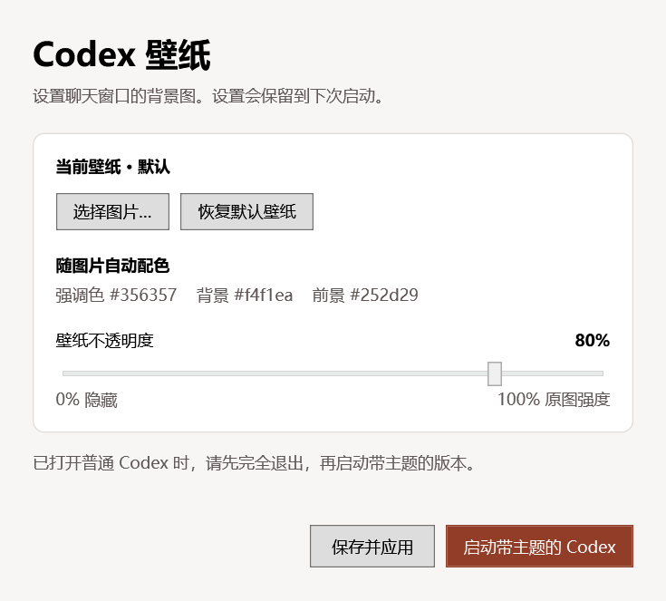
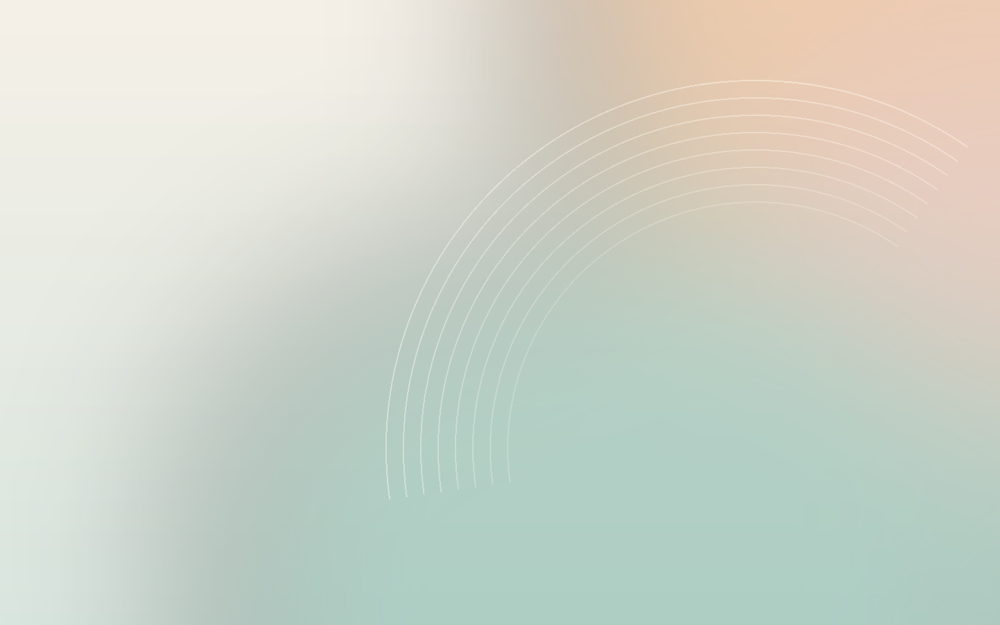

# Wallpaper Desk 中文发布页

[English](README.md) · [v0.1.0 发布记录](https://github.com/Phoenitree/wallpaper-desk/releases/tag/v0.1.0) · [下载 Windows ZIP](https://github.com/Phoenitree/wallpaper-desk/releases/download/v0.1.0/WallpaperDesk-v0.1.0.zip)

Wallpaper Desk 是一个独立的 Windows 壁纸工具，适用于 Microsoft Store 版 Codex。壁纸绘制在聊天内容下方。你可以使用本地图片、调节壁纸不透明度，并让工具从图片中自动提取强调色、背景色和前景色。

## 控制台预览

## 安装与使用

1. 从 Microsoft Store 安装 Codex，安装 Python 3.11 或更新版本并添加到 PATH。
2. [下载并完整解压 ZIP](https://github.com/Phoenitree/wallpaper-desk/releases/download/v0.1.0/WallpaperDesk-v0.1.0.zip)。在解压目录运行 `python -m pip install -r requirements.txt`，用于图片取色。
3. 完全退出已打开的普通 Codex。双击 `Open-WallpaperDesk.vbs`，选择「启动带主题的 Codex」。
4. 选择 12 MB 以内的 PNG、JPG 或 WebP，调节滑块后点「保存并应用」。0% 隐藏壁纸，100% 显示原图强度。「恢复默认壁纸」可切回内置抽象图。

也可以运行 `wscript.exe Open-WallpaperDesk.vbs start` 直接启动主题版。本地设置和日志存放在 `%LOCALAPPDATA%\WallpaperDesk`。

## 内置壁纸

## 兼容性与许可

主题会话运行期间会开启仅本机可访问的 Chromium 调试端口。同一台电脑上的其他程序也可能连接该端口。完全退出主题版 Codex 后，端口随之关闭。Codex 更新后可能需要适配样式。如果本地配置格式受支持，应用新图片或恢复默认图片也会同步三个原生外观颜色。

Wallpaper Desk 是非官方项目，与 OpenAI 没有隶属或背书关系。项目源码和内置程序生成的原创抽象图采用 [MIT 许可](LICENSE)。如需分享自定义图片，请先确认自己拥有相应使用和分发权利。
